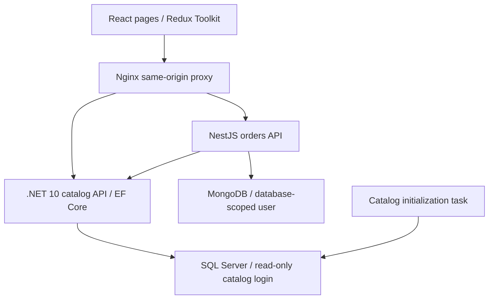

# Architecture

The frontend loads category/product data through the .NET service and holds the cart in Redux. Checkout validates Hebrew fields and posts the order to the independent NestJS service. NestJS verifies product snapshots through the catalog API and saves the order in MongoDB with a unique request ID. A changed retry receives 409 rather than overwriting saved details.

The catalog initialization task uses EF to create and seed the dedicated SQL database, then grants a fixed runtime login SELECT access only on category/product tables. MongoDB creates a database-scoped application user on a new volume. Existing unauthenticated volumes require the documented non-destructive user migration.
